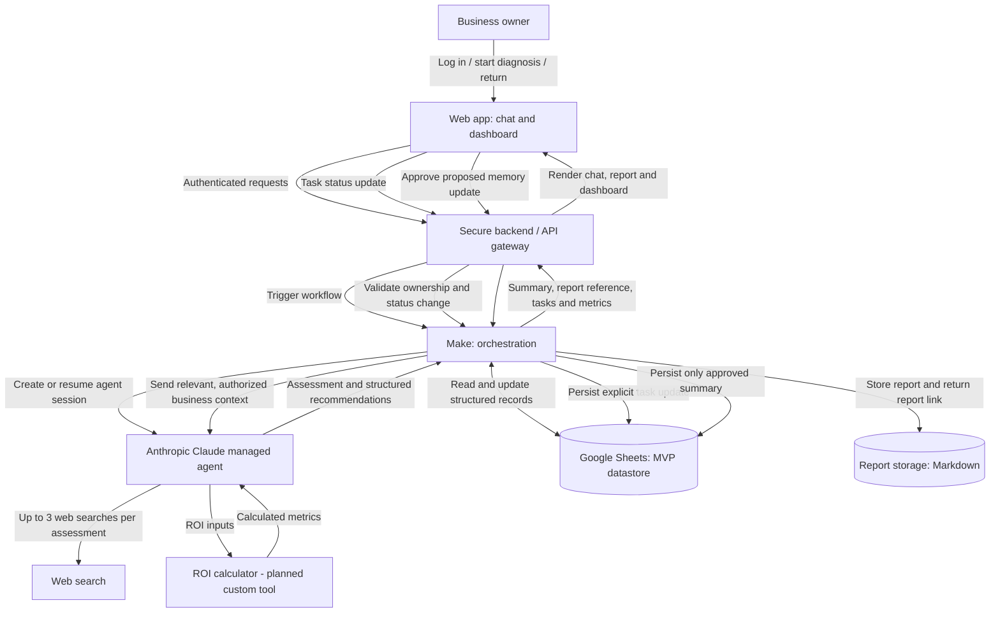

# Architecture — AI Business Opportunity Advisor

**Version:** 1.0 — Architecture proposal  
**Status:** Design only; integrations, persistent storage, custom ROI tool and dashboard are not yet implemented.  
**Initial scope:** One small business (MVP), with an extensible data model.  
**User-facing language:** Hebrew.

## 1. Goal

Provide a single web interface in which a small-business owner can converse freely with an AI advisor, receive up to three prioritized AI opportunities, review a detailed report and phased implementation plan, and update task progress in an interactive dashboard. The system should retain approved business context for subsequent visits.

## 2. System architecture

> The diagram shows a **proposed** architecture, not an already connected system. The secure backend is a necessary design component for identity, authorization, secret management and API calls; its implementation technology has not yet been chosen. The feasibility of connecting Make to the existing Claude managed agent must be verified against available Anthropic APIs and account capabilities. If a direct managed-agent invocation is unavailable, a supported Anthropic API integration would be needed without implying that the existing agent is already callable from Make.

## 3. Triggers

### Trigger A: New business assessment
1. The owner signs in to the web app and selects **Start assessment**.
2. The backend verifies the user's identity and authorizes access to the business record.
3. Make creates an assessment workflow and starts or resumes an authorized Claude session.
4. The agent conducts a **free-form conversation**, asking adaptive follow-up questions.
5. When enough information is available, the agent proposes up to three opportunities, evidence and an implementation plan.

### Trigger B: Returning business / progress review
1. The owner signs in and selects **Continue / review progress**.
2. The backend loads only the owner's approved business summary, recommendations and task statuses from Google Sheets.
3. Make supplies the relevant context to Claude, which asks about progress and suggests next steps in chat.
4. New agent-generated memory summaries are stored **only after explicit owner approval**.

### Trigger C: Dashboard task update
1. The owner changes a task status: **Not started / In progress / Completed**.
2. The backend validates identity, business ownership, task ID and allowed status.
3. Make updates the relevant Google Sheets row and records an update timestamp.
4. The dashboard refreshes; the new status becomes available to the agent on the next authorized session.

Task-status changes are explicit user actions and can be saved directly; agent-inferred business facts or summaries require a separate approval step.

## 4. Main components

| Component | Responsibility | MVP status |
| --- | --- | --- |
| Web app (planned with Claude Code) | Hebrew chat, assessment start/continue, report viewer, interactive dashboard | Planned |
| Secure backend/API | Authentication, per-business authorization, session routing, secret storage, input validation | Planned |
| Make | Trigger handling, workflow orchestration, data exchange, retries and error handling | Planned |
| Claude managed agent | Adaptive business interview, AI opportunity analysis, prioritized recommendations and phased plan | Agent created; end-to-end integration not tested |
| Web search | Verify relevant solutions and sources; max three searches per assessment | Agent permission configured; usage not tested |
| ROI calculator | Calculate savings, costs, net benefit, ROI and payback only from owner-supplied values | Planned, not implemented |
| Google Sheets | Persistent structured business data and progress records | Selected for MVP; not connected |
| Markdown report storage | Store detailed assessment reports and make authorized links available | Planned; storage provider TBD |
| Dashboard | Display business profile, top opportunities, ROI, plan and editable task statuses | Planned |

## 5. Data model — Google Sheets

Use separate tabs (tables) with stable IDs. Although the MVP serves one business, include `business_id` to support future expansion. The ID is **not** an authentication credential.

| Tab | Example fields | Notes |
| --- | --- | --- |
| Businesses | business_id, owner_user_id, industry, business_size, approved_summary, updated_at | Store minimal approved business context |
| Assessments | assessment_id, business_id, started_at, completed_at, status, report_id | One row per assessment |
| Opportunities | opportunity_id, assessment_id, business_id, priority, title, challenge, solution, evidence_links | Maximum three per assessment |
| ROI | opportunity_id, input_hours, hourly_cost, implementation_cost, ongoing_cost, period, estimated_savings, net_benefit, roi_percent, payback_period, assumptions | Leave unavailable values blank; never invent inputs |
| Tasks | task_id, opportunity_id, business_id, description, status, updated_at | Editable by authorized owner |
| Reports | report_id, assessment_id, business_id, storage_reference, created_at | Reference to private Markdown report |
| Approvals | approval_id, business_id, proposed_change, approval_status, approved_at | Audit approvals without retaining unnecessary transcripts |

The prior SPEC proposed per-business JSON memory. In this MVP, Google Sheets is the persistent store; structured JSON can be used **in transit** between the web app, Make and the agent. This is an explicit architecture change, not a claim that JSON file persistence is implemented.

## 6. Output handling

1. **Chat summary:** Show key challenges and up to three prioritized AI opportunities.
2. **Detailed Markdown report:** Include business context, each opportunity, sources and confidence limits, ROI where calculable, assumptions and a phased implementation plan.
3. **Dashboard:** Show the three opportunities, estimated hours and monetary impact (if supported), task statuses and next steps.
4. **Approved memory:** Persist only the owner's approved business summary and updates, rather than the raw chat transcript.
5. **Progress feedback:** Owner edits task statuses; the next agent session can use those updates to tailor its guidance.

## 7. ROI policy

The agent must not fabricate revenue, labor costs, hours saved or implementation costs. The planned calculator will receive explicitly supplied inputs and return computed results with units, period and assumptions. If inputs are missing, the system will request them or show **ROI not calculated — insufficient data**. Estimates are not guaranteed outcomes.

## 8. Security, privacy and reliability

- Authenticate users; verify ownership for every business, task, report and assessment request.
- Keep Anthropic, Make and Google credentials on the server, never in browser code or public GitHub files.
- Use HTTPS and limit access to Sheets and private reports.
- Collect only necessary business data; do not store customer personal data or raw conversation transcripts by default.
- Ask for explicit approval before persisting new agent-generated memory; provide correction and deletion paths.
- Validate webhook signatures or equivalent request authentication, and protect against duplicate events.
- Record errors and workflow IDs without exposing sensitive contents.
- Limit web research to three searches per assessment, including retries; if unavailable, label unsupported claims as unverified.
- If Make, Claude or Sheets fails, show a clear error and avoid silently reporting success. Use bounded retries and idempotent updates.
- Google Sheets is appropriate for a small demo, not necessarily for production-scale concurrency or sensitive workloads.

## 9. Example end-to-end flow

**New assessment:** Owner opens web app → authenticated backend → Make workflow → Claude interview → optional web search and ROI calculator → recommendations → Make → Google Sheets (structured data subject to approval rules) and private Markdown report storage → web dashboard and report viewer.

**Progress update:** Owner marks task “In progress” → backend authorization → Make → Google Sheets → dashboard reflects update → Claude reads the new status during the next authorized visit.

**Memory update:** Claude proposes an updated business summary → owner reviews and approves → backend → Make → Google Sheets → summary available for future sessions.

## 10. Suggested MVP acceptance tests

1. A new owner starts a free-form assessment and sees an adaptive follow-up question.
2. The agent returns no more than three opportunities and identifies evidence limitations.
3. Missing ROI inputs produce no fabricated numbers.
4. The report and dashboard show matching opportunity/task identifiers.
5. Changing a task status persists and is visible after refreshing the dashboard.
6. A returning owner sees the approved business context and latest task statuses.
7. An unapproved agent-generated summary is **not** stored.
8. An unauthorized user cannot read or change another business's data.
9. A failed workflow displays an error and does not falsely confirm saving.
10. The web-search limit is respected even when a search fails.

## 11. Implementation sequence (future work)

1. Confirm the supported API route between Make and the existing Anthropic managed agent.
2. Define the Google Sheets tabs and sample records.
3. Build a secure backend with login, authorization and protected credentials.
4. Connect Make to the backend, Claude and Google Sheets.
5. Implement the ROI calculator and report storage.
6. Build the Hebrew web interface and interactive dashboard.
7. Test the three triggers, approval flow, privacy rules and failure cases.

**Current submission:** This file documents the proposed system architecture for the assignment. It does not claim that the integrations, web app, dashboard or persistent memory are already operational.
